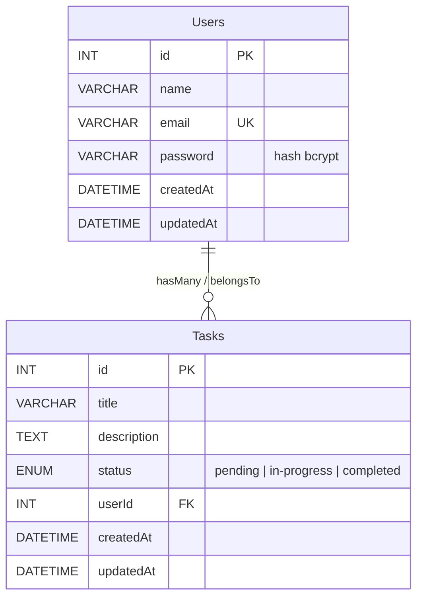

# Task Manager API

API RESTful segura para gestionar tareas, con autenticación mediante **JSON Web Tokens (JWT)**.
Cada usuario se registra, inicia sesión y solo puede ver, crear, actualizar y eliminar **sus propias** tareas.

**Stack:** Node.js · Express 5 · Sequelize 6 · MySQL · JWT · bcrypt · pnpm

---

## Índice

- [Características](#características)
- [Estructura del proyecto](#estructura-del-proyecto)
- [Requisitos previos](#requisitos-previos)
- [Instalación](#instalación)
- [Variables de entorno](#variables-de-entorno)
- [Scripts disponibles](#scripts-disponibles)
- [Base de datos](#base-de-datos)
- [Autenticación](#autenticación)
- [Endpoints](#endpoints)
- [Formato de errores](#formato-de-errores)
- [Seguridad implementada](#seguridad-implementada)
- [Pruebas con Postman](#pruebas-con-postman)
- [Capturas de pruebas](#capturas-de-pruebas)

---

## Características

- Registro de usuarios con email único y contraseña encriptada con **bcrypt**.
- Login que valida credenciales y devuelve un **JWT** firmado (HS256) con expiración.
- Middleware que verifica el token en el header `Authorization: Bearer <token>`.
- CRUD de tareas protegido: un usuario **solo** puede ver y modificar sus tareas.
- Validación de datos de entrada con `express-validator`.
- Migraciones de Sequelize **y** script SQL alternativo.
- Colección de Postman con **44 tests automáticos**, ejecutable también por consola con Newman.

## Estructura del proyecto

```
task-manager-api/
├── .env.example                 # Plantilla de variables de entorno
├── .sequelizerc                 # Rutas para sequelize-cli
├── database/
│   └── schema.sql               # Script SQL (alternativa a las migraciones)
├── docs/screenshots/            # Capturas de las pruebas
├── postman/
│   └── task-manager-api.postman_collection.json
└── src/
    ├── app.js                   # Configuración de Express (middlewares y rutas)
    ├── server.js                # Punto de entrada: conecta a MySQL y levanta el servidor
    ├── config/
    │   ├── env.js               # Carga y valida variables de entorno
    │   └── database.js          # Configuración de Sequelize / sequelize-cli
    ├── controllers/             # Lógica de cada endpoint
    ├── database/migrations/     # Migraciones Sequelize (Users, Tasks)
    ├── middlewares/
    │   ├── auth.middleware.js   # Verificación del JWT
    │   ├── validate.middleware.js
    │   └── error.middleware.js  # 404 y manejador central de errores
    ├── models/                  # Modelos User y Task + relaciones
    ├── routes/                  # Definición de rutas /api/auth y /api/tasks
    ├── utils/                   # AppError, helpers de JWT
    └── validators/              # Reglas de validación de entrada
```

## Requisitos previos

| Herramienta | Versión |
| ----------- | ------- |
| Node.js     | 20 o superior (probado con 24) |
| pnpm        | 9 o superior (probado con 12) |
| MySQL       | 8 o superior (probado con 9.7) |

## Instalación

```bash
# 1. Clonar el repositorio
git clone https://github.com/<tu-usuario>/task-manager-api.git
cd task-manager-api

# 2. Instalar dependencias
pnpm install

# 3. Crear el archivo de entorno y completarlo (usuario/contraseña de MySQL y JWT_SECRET)
cp .env.example .env

# 4. Crear la base de datos y las tablas
pnpm db:create
pnpm db:migrate

# 5. Levantar el servidor (modo desarrollo con recarga automática)
pnpm dev
```

La API queda disponible en `http://localhost:3000/api`. Comprueba que funciona con:

```bash
curl http://localhost:3000/api/health
# {"status":"ok"}
```

> **Alternativa sin migraciones:** puedes crear la base de datos y las tablas ejecutando el script SQL:
> `mysql -u root -p < database/schema.sql`

## Variables de entorno

Definidas en `.env` (usa `.env.example` como plantilla). **Nunca subas tu `.env` al repositorio**: ya está incluido en `.gitignore`.

| Variable | Descripción | Ejemplo / valor por defecto |
| -------- | ----------- | --------------------------- |
| `NODE_ENV` | Entorno de ejecución | `development` |
| `PORT` | Puerto del servidor | `3000` |
| `CORS_ORIGIN` | Orígenes permitidos por CORS | `*` |
| `DB_HOST` | Host de MySQL **(obligatoria)** | `127.0.0.1` |
| `DB_PORT` | Puerto de MySQL | `3306` |
| `DB_NAME` | Nombre de la base de datos **(obligatoria)** | `task_manager` |
| `DB_USER` | Usuario de MySQL **(obligatoria)** | `root` |
| `DB_PASSWORD` | Contraseña de MySQL | *(vacío)* |
| `DB_LOGGING` | Mostrar las consultas SQL en consola | `false` |
| `JWT_SECRET` | Secreto para firmar los tokens, mínimo 32 caracteres **(obligatoria)** | — |
| `JWT_EXPIRES_IN` | Duración del token | `1h` |
| `BCRYPT_SALT_ROUNDS` | Coste del hash bcrypt | `10` |
| `AUTH_RATE_LIMIT_WINDOW_MINUTES` | Ventana del limitador de intentos en `/auth` | `15` |
| `AUTH_RATE_LIMIT_MAX` | Peticiones máximas por IP en esa ventana | `100` |

Genera un `JWT_SECRET` seguro con:

```bash
node -e "console.log(require('crypto').randomBytes(48).toString('hex'))"
```

Si falta alguna variable obligatoria, la aplicación no arranca y muestra cuál falta.

## Scripts disponibles

| Comando | Descripción |
| ------- | ----------- |
| `pnpm dev` | Inicia el servidor con recarga automática (`node --watch`) |
| `pnpm start` | Inicia el servidor en modo normal |
| `pnpm db:create` | Crea la base de datos definida en `DB_NAME` |
| `pnpm db:migrate` | Ejecuta las migraciones (crea `Users` y `Tasks`) |
| `pnpm db:migrate:undo` | Revierte todas las migraciones |
| `pnpm db:reset` | Revierte y vuelve a ejecutar las migraciones (borra los datos) |
| `pnpm test:postman` | Ejecuta la colección de Postman con Newman (requiere el servidor en marcha) |

## Base de datos



- **User → hasMany → Tasks** y **Task → belongsTo → User** (`src/models`).
- `Tasks.userId` es clave foránea a `Users.id` con `ON DELETE CASCADE`: si se elimina un usuario, se eliminan sus tareas.
- Migraciones en `src/database/migrations` · Script SQL equivalente en `database/schema.sql`.

## Autenticación

1. Registra un usuario con `POST /api/auth/register`.
2. Inicia sesión con `POST /api/auth/login` y copia el `token` de la respuesta.
3. Envía el token en **todas** las peticiones a `/api/tasks` con el header:

```
Authorization: Bearer <token>
```

El token expira según `JWT_EXPIRES_IN` (1 hora por defecto); después hay que volver a iniciar sesión.

## Endpoints

URL base: `http://localhost:3000/api`

| Método | Endpoint | Protegido | Descripción |
| ------ | -------- | :-------: | ----------- |
| GET | `/health` | No | Estado de la API |
| POST | `/auth/register` | No | Registrar usuario |
| POST | `/auth/login` | No | Iniciar sesión y obtener JWT |
| GET | `/auth/me` | **JWT** | Datos del usuario autenticado |
| GET | `/tasks` | **JWT** | Listar tareas del usuario (filtro opcional `?status=`) |
| GET | `/tasks/:id` | **JWT** | Obtener una tarea propia |
| POST | `/tasks` | **JWT** | Crear tarea |
| PUT | `/tasks/:id` | **JWT** | Actualizar tarea propia |
| DELETE | `/tasks/:id` | **JWT** | Eliminar tarea propia |

### `POST /api/auth/register`

```json
{
  "name": "Ana Pérez",
  "email": "ana@example.com",
  "password": "Password123"
}
```

Reglas: `name` 2–100 caracteres · `email` válido y único · `password` 8–72 caracteres con al menos una letra y un número.

**201 Created**

```json
{
  "message": "Usuario registrado correctamente",
  "user": {
    "id": 1,
    "name": "Ana Pérez",
    "email": "ana@example.com",
    "createdAt": "2026-11-13T04:29:47.000Z",
    "updatedAt": "2026-11-13T04:29:47.000Z"
  }
}
```

Errores: `400` datos inválidos · `409` email ya registrado.

### `POST /api/auth/login`

```json
{
  "email": "ana@example.com",
  "password": "Password123"
}
```

**200 OK**

```json
{
  "message": "Inicio de sesión exitoso",
  "token": "eyJhbGciOiJIUzI1NiIsInR5cCI6IkpXVCJ9...",
  "tokenType": "Bearer",
  "expiresIn": "1h",
  "user": { "id": 1, "name": "Ana Pérez", "email": "ana@example.com" }
}
```

Errores: `400` datos inválidos · `401` credenciales inválidas (mismo mensaje si falla el email o la contraseña).

### `GET /api/tasks`

Devuelve solo las tareas del usuario del token, de la más reciente a la más antigua.
Filtro opcional: `GET /api/tasks?status=pending` (`pending`, `in-progress`, `completed`).

**200 OK**

```json
{
  "count": 1,
  "tasks": [
    {
      "id": 1,
      "title": "Preparar entrega",
      "description": "README + colección Postman",
      "status": "in-progress",
      "userId": 1,
      "createdAt": "2026-11-13T04:29:47.000Z",
      "updatedAt": "2026-11-13T04:29:47.000Z"
    }
  ]
}
```

### `POST /api/tasks`

```json
{
  "title": "Estudiar JWT",
  "description": "Repasar firma, expiración y header Authorization",
  "status": "pending"
}
```

`title` obligatorio (1–150) · `description` opcional · `status` opcional (por defecto `pending`).
El `userId` se toma **siempre del token**; si se envía en el body se ignora.

**201 Created** → `{ "message": "Tarea creada correctamente", "task": { ... } }`

### `PUT /api/tasks/:id`

Actualiza uno o varios campos (`title`, `description`, `status`). Hay que enviar al menos uno.

```json
{
  "status": "completed"
}
```

**200 OK** → `{ "message": "Tarea actualizada correctamente", "task": { ... } }`

### `DELETE /api/tasks/:id`

**200 OK** → `{ "message": "Tarea eliminada correctamente", "id": 1 }`

> En `GET`, `PUT` y `DELETE /api/tasks/:id`, si la tarea no existe **o pertenece a otro usuario** se responde `404 Tarea no encontrada`, sin revelar que la tarea existe.

## Formato de errores

Todos los errores devuelven JSON con un `message` y, en errores de validación, la lista `errors`:

```json
{
  "message": "Error de validación",
  "errors": [
    { "field": "title", "message": "El título es obligatorio" },
    { "field": "status", "message": "El estado debe ser uno de: pending, in-progress, completed" }
  ]
}
```

| Código | Cuándo |
| ------ | ------ |
| `400` | Datos inválidos, JSON mal formado o id no numérico |
| `401` | Token ausente, mal formado, inválido, expirado o credenciales incorrectas |
| `404` | Ruta inexistente o tarea que no existe / no es del usuario |
| `409` | Email ya registrado |
| `429` | Demasiados intentos en `/auth/register` o `/auth/login` |
| `500` | Error interno |

## Seguridad implementada

- **bcrypt:** las contraseñas se guardan como hash (hook `beforeSave` del modelo `User`); nunca se devuelven en las respuestas (`defaultScope` + `toJSON`).
- **JWT:** firmados con HS256 y expiración; al verificar se fija el algoritmo (`algorithms: ['HS256']`) para rechazar tokens `alg: none` o firmados con otra clave.
- **Middleware de autenticación** (`src/middlewares/auth.middleware.js`): exige `Authorization: Bearer <token>`, distingue token expirado / inválido y comprueba que el usuario del token siga existiendo.
- **Autorización por propietario:** todas las consultas de tareas filtran por `userId` del token.
- **Variables de entorno:** credenciales y secretos fuera del código; se validan al arrancar (`JWT_SECRET` ≥ 32 caracteres).
- **Validación de entrada** con `express-validator` y lista blanca de campos (no se puede asignar `userId` ni `id` desde el body).
- **Login sin filtración de información:** mismo mensaje y tiempo de respuesta similar si el email no existe o la contraseña es incorrecta.
- **Rate limiting** en registro y login, cabeceras seguras con **helmet**, **CORS** configurable y límite de 10 kB en el body.

## Pruebas con Postman

1. Abre Postman → **Import** → selecciona `postman/task-manager-api.postman_collection.json`.
2. Con el servidor en marcha (`pnpm dev`), ejecuta las carpetas en orden o usa el **Collection Runner**.
3. La petición **Login** guarda automáticamente el token en la variable de colección `token`, y todas las peticiones de tareas lo envían como `Bearer {{token}}`.

Si tu servidor no usa el puerto 3000, cambia la variable de colección `baseUrl`.

La colección incluye:

| Carpeta | Qué prueba |
| ------- | ---------- |
| `0. Health` | La API responde |
| `1. Auth` | Registro, email duplicado (409), validación (400), login, credenciales inválidas (401), `/me` |
| `2. Tasks` | Crear, validar, listar, obtener, actualizar, filtrar por estado, eliminar y comprobar 404 |
| `3. Seguridad y autorización` | Sin token (401), token inválido (401) y un segundo usuario que **no** puede ver, editar ni borrar las tareas del primero (404) |

También se puede ejecutar por consola (con el servidor levantado):

```bash
pnpm test:postman
```

## Capturas de pruebas

Ejecución real de la colección con Newman (`pnpm test:postman`): **25 peticiones, 44 aserciones, 0 fallos**.

### Registro y login


### CRUD de tareas protegido con JWT


### Seguridad: sin token, token inválido y acceso a tareas de otro usuario


### Resumen de la ejecución


### Login con JWT y acceso a una ruta protegida (curl)


### Contraseñas almacenadas como hash bcrypt en MySQL


